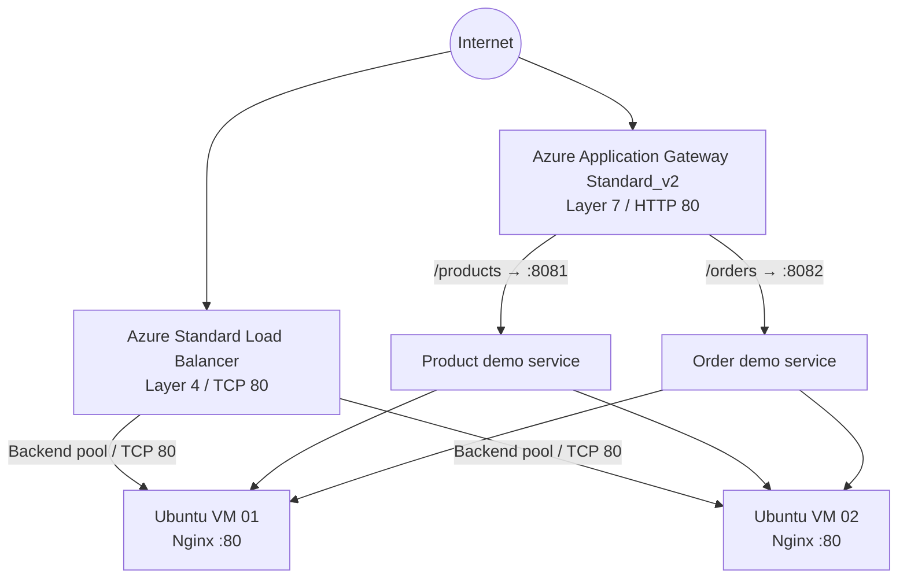

# Azure Load Balancer vs Application Gateway

A hands-on Microsoft Azure networking project that demonstrates the difference between **Layer 4 load balancing** and **Layer 7 application-aware routing** using Azure Bicep, Ubuntu virtual machines, Nginx, and lightweight Python HTTP services.

> **Deployment status:** This repository contains infrastructure-as-code and deployment instructions. Do not describe the environment as successfully deployed until you have deployed it in your own Azure subscription and captured the test evidence.

## Table of contents

- [1. Introduction](#1-introduction)
- [2. Problem statement](#2-problem-statement)
- [3. Objectives](#3-objectives)
- [4. Solution overview](#4-solution-overview)
- [5. Architecture](#5-architecture)
- [6. Technology stack](#6-technology-stack)
- [7. Repository structure](#7-repository-structure)
- [8. Prerequisites](#8-prerequisites)
- [9. Deployment on Windows](#9-deployment-on-windows)
- [10. Test plan](#10-test-plan)
- [11. Azure Load Balancer vs Application Gateway](#11-azure-load-balancer-vs-application-gateway)
- [12. Security and cost notes](#12-security-and-cost-notes)
- [13. Cleanup](#13-cleanup)
- [14. Documentation parts](#14-documentation-parts)
- [15. Conclusion](#15-conclusion)

## 1. Introduction

Modern applications need to distribute incoming requests across backend resources to improve availability and avoid overloading a single server. Azure provides several traffic-distribution services, including Azure Load Balancer and Azure Application Gateway. They solve related but different problems.

This project builds a small lab in which both services can be explored side by side:

- **Azure Load Balancer** distributes TCP flows to healthy backend virtual machines.
- **Azure Application Gateway** accepts HTTP requests and routes them based on URL paths.
- Two Ubuntu backend VMs host Nginx and demo services.
- Azure Bicep defines the infrastructure declaratively so it can be reviewed, repeated, and version-controlled.

The lab is for learning and demonstration, not a production reference architecture.

## 2. Problem statement

When an application is hosted on one server, that server can become a bottleneck or a single point of failure. As traffic grows, the system needs a way to distribute requests among healthy backends. In a multi-service application, different URL paths may also need to reach different services.

The design question is: **When should a team use Layer 4 load balancing, and when is Layer 7 HTTP routing required?** This project demonstrates both approaches using a reproducible Azure deployment.

### Problem scope

1. Demonstrate traffic distribution to backend VMs using a Standard Azure Load Balancer.
2. Demonstrate path-based HTTP routing using Application Gateway.
3. Configure health probes and backend pools.
4. Define the lab with Bicep rather than creating every resource manually.
5. Document deployment, validation, limitations, and safe cleanup.

## 3. Objectives

- Understand Layer 4 versus Layer 7 traffic handling.
- Create a virtual network with separate backend and Application Gateway subnets.
- Provision two Ubuntu VMs and configure demo endpoints with cloud-init.
- Configure a Load Balancer frontend, backend pool, health probe, and rule.
- Configure an Application Gateway HTTP listener, backend pools, HTTP settings, probes, and path rules.
- Validate expected behavior using `curl.exe` and Azure CLI.
- Keep the infrastructure and documentation in GitHub for review and reuse.

## 4. Solution overview

The same two backend VMs are shared by both demonstrations to keep the lab smaller. Nginx listens on port `80`. Two Python HTTP services listen on ports `8081` and `8082`.

| Entry point | Routing behavior | Expected result |
|---|---|---|
| Load Balancer public IP, `/` | TCP flow to a healthy VM on port 80 | Nginx page showing backend hostname |
| Load Balancer public IP, `/health` | TCP flow to a healthy VM on port 80 | `UP` |
| Application Gateway public IP, `/products` | Path rule to product backend on port 8081 | JSON with `product-service` role |
| Application Gateway public IP, `/orders` | Path rule to order backend on port 8082 | JSON with `order-service` role |

## 5. Architecture



The Application Gateway path map uses separate backend pools and backend HTTP settings for the product and order endpoints. The exact health state and behavior must be confirmed after deployment in the Azure portal or with Azure CLI.

See [`docs/ARCHITECTURE.md`](docs/ARCHITECTURE.md) for a more detailed view.

## 6. Technology stack

- Microsoft Azure
- Azure Load Balancer (Standard SKU)
- Azure Application Gateway (Standard_v2 SKU)
- Azure Virtual Network, subnets, public IPs, and Network Security Groups
- Azure Bicep and Azure Resource Manager
- Ubuntu Linux, Nginx, Python 3, systemd
- Azure CLI and PowerShell
- Markdown and Mermaid for documentation diagrams

## 7. Repository structure

```text
Azure_LoadBalancer_vs_ApplicationGateway_Real_Azure_Project/
├── README.md
├── infra/
│   └── main.bicep
├── backend/
│   └── cloud-init.sh
├── scripts/
│   ├── deploy.sh
│   ├── DEPLOY_WINDOWS.md
│   └── cleanup.ps1
└── docs/
    ├── 01-introduction-problem-statement.md
    ├── 02-abstraction-architecture.md
    ├── 03-implementation-code-walkthrough.md
    ├── 04-deployment-testing.md
    ├── 05-results-conclusion.md
    ├── ARCHITECTURE.md
    └── REAL_AZURE_REPORT.md
```

## 8. Prerequisites

- An Azure subscription with permission to create networking, public IP, VM, Load Balancer, and Application Gateway resources.
- Azure CLI installed and available in PowerShell.
- A region that supports the required VM size and Application Gateway SKU for your subscription.
- Local Git installed if you plan to use Git commands.
- Awareness that public IPs, VMs, and Application Gateway can incur charges while provisioned.

Check Azure CLI and sign in:

```powershell
az version
az login
az account show
```

## 9. Deployment on Windows

Open PowerShell in the extracted project directory.

### Step 1 — Validate the Bicep template

```powershell
az bicep build --file .\infra\main.bicep
```

Resolve any validation errors before provisioning resources. Review the template and current Azure pricing before deployment.

### Step 2 — Set the deployment variables

```powershell
$RG = "rg-lb-agw-real-demo"
$LOCATION = "eastus"
```

Change the region if necessary.

### Step 3 — Create the resource group

```powershell
az group create --name $RG --location $LOCATION
```

### Step 4 — Deploy the template

The Windows deployment guide contains the full command sequence and test commands: [`scripts/DEPLOY_WINDOWS.md`](scripts/DEPLOY_WINDOWS.md).

**Credential safety:** Use a strong, unique VM admin password. Do not put real passwords in source files, screenshots, shell history, Git commits, or public issue reports. The Bicep parameter is marked secure, but shell handling and deployment history still deserve care.

### Step 5 — Wait and inspect

```powershell
az deployment group show `
  --resource-group $RG `
  --name main `
  --query properties.provisioningState `
  -o tsv
```

Continue only after deployment reports success. If it fails, inspect the deployment operations and fix the reported issue before testing.

### Step 6 — Get the public IP addresses

```powershell
$LBIP = az network public-ip show -g $RG -n pip-lb --query ipAddress -o tsv
$AGWIP = az network public-ip show -g $RG -n pip-agw --query ipAddress -o tsv

$LBIP
$AGWIP
```

## 10. Test plan

Run the tests only after the deployment has completed successfully.

```powershell
curl.exe "http://$LBIP/"
curl.exe "http://$LBIP/health"
curl.exe "http://$AGWIP/products"
curl.exe "http://$AGWIP/orders"
```

Expected outcomes are documented in [`docs/04-deployment-testing.md`](docs/04-deployment-testing.md). Record actual outputs and screenshots; never invent test results.

## 11. Azure Load Balancer vs Application Gateway

| Feature | Azure Load Balancer | Azure Application Gateway |
|---|---|---|
| OSI layer | Layer 4 | Layer 7 |
| Main focus | TCP/UDP traffic distribution | HTTP/HTTPS application delivery |
| Routing decision | IP addresses, ports, protocol, health | HTTP request attributes such as URL path and host |
| Path-based routing | No | Yes |
| HTTP listener and backend HTTP settings | No | Yes |
| Typical use | General network traffic distribution | Web applications, path/host routing, web traffic features |
| This lab | Port 80 to healthy VM backends | `/products` and `/orders` to different backend ports |

Neither service is universally better. Choose based on protocol, routing requirements, security needs, availability targets, and cost.

## 12. Security and cost notes

- This is an HTTP demonstration; it does not configure TLS certificates or HTTPS.
- Do not use real customer data or production credentials.
- Review NSG rules and access paths before deployment. The lab's SSH rule is intended to be limited to virtual-network sources, not public Internet access.
- Do not publish public IPs, credentials, subscription IDs, or sensitive portal details in screenshots.
- Application Gateway and public IP resources can be costly for a student lab. Check the current Azure pricing calculator for your region and SKU.
- Stop is not always the same as deallocation, and deleting only a VM may leave billable networking resources. Delete the entire dedicated resource group when finished.

## 13. Cleanup

After collecting evidence, remove the dedicated lab resource group:

```powershell
az group delete --name $RG --yes --no-wait
```

Confirm deletion in the Azure portal or:

```powershell
az group exists --name $RG
```

Expected output after deletion completes: `false`. Never run cleanup against a resource group containing unrelated resources.

## 14. Documentation parts

1. [Introduction and Problem Statement](docs/01-introduction-problem-statement.md)
2. [Abstraction and Architecture](docs/02-abstraction-architecture.md)
3. [Implementation and Code Walkthrough](docs/03-implementation-code-walkthrough.md)
4. [Deployment and Testing](docs/04-deployment-testing.md)
5. [Results, Limitations and Conclusion](docs/05-results-conclusion.md)

## 15. Conclusion

This project provides a practical comparison of two Azure traffic-management services. The Load Balancer example illustrates Layer 4 distribution to healthy VM backends, while Application Gateway illustrates Layer 7 routing by URL path. Infrastructure-as-code makes the environment easier to inspect and reproduce. The final report should include measured test evidence and clearly distinguish expected behavior from results actually observed in Azure.
"# azure-load-balancer-vs-application-gateway" 
