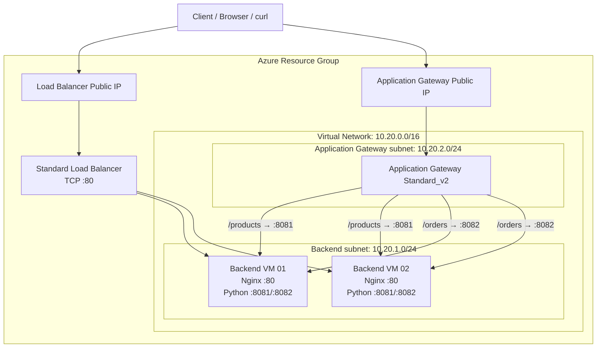
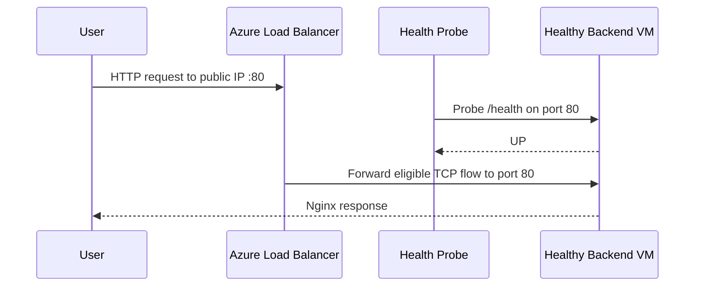
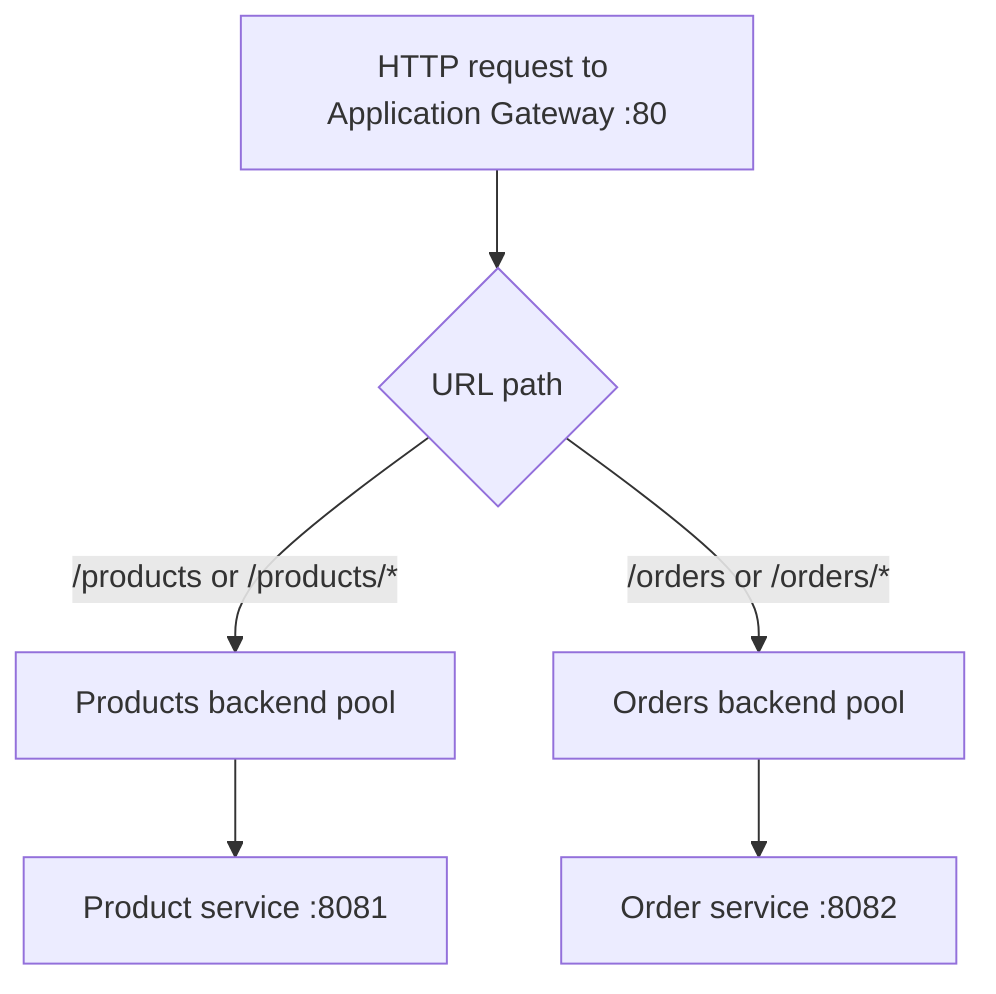

# Part 2 — Abstraction and Architecture

## 2.1 Abstract

This project compares two Azure traffic distribution approaches in a reproducible cloud lab. Azure Load Balancer is used to demonstrate Layer 4 TCP flow distribution to healthy backend virtual machines. Azure Application Gateway is used to demonstrate Layer 7 HTTP path-based routing, sending `/products` and `/orders` requests to different backend ports. The infrastructure is described with Azure Bicep, while cloud-init configures Nginx and small Python HTTP services on Ubuntu VMs. The project includes a deployment guide, validation commands, expected outputs, and cleanup instructions. It is intended for education and portfolio demonstration, not as a production architecture.

## 2.2 Keywords

Microsoft Azure, Azure Load Balancer, Application Gateway, Layer 4, Layer 7, Bicep, cloud-init, Nginx, virtual network, health probe, path-based routing.

## 2.3 Conceptual abstraction

The system can be understood as four layers:

1. **Client layer:** A browser or command-line client sends HTTP requests to a public IP.
2. **Traffic management layer:** The Load Balancer or Application Gateway receives traffic and applies its configured distribution/routing behavior.
3. **Backend layer:** Two Ubuntu VMs host Nginx and Python services.
4. **Infrastructure layer:** A virtual network, subnets, public IPs, NSGs, and Azure resource configuration provide connectivity and access control.

## 2.4 High-level architecture diagram

The diagram describes intended traffic flows. Confirm the deployed backend pool addresses, probes, and routing rules in the actual Azure environment.

## 2.5 Request flow

### Load Balancer flow

The Load Balancer operates at Layer 4. It does not route to a backend based on `/products` versus `/orders`; the HTTP path is carried inside the TCP stream and is not the Load Balancer's routing key.

### Application Gateway flow

The Application Gateway listener accepts HTTP traffic, then the URL path map selects the backend pool and backend HTTP settings. The service responds with JSON including its role and port.

## 2.6 Main Azure components

| Component | Purpose |
|---|---|
| Resource group | Groups the resources for the lab and enables whole-lab cleanup |
| Virtual network | Provides private IP connectivity |
| Backend subnet | Hosts the backend VMs |
| Application Gateway subnet | Dedicated subnet for Application Gateway |
| Network Security Group | Controls allowed network flows to the backend subnet |
| Public IPs | Provide public entry points to the Load Balancer and Application Gateway |
| Standard Load Balancer | Distributes TCP flows to the backend pool |
| Application Gateway Standard_v2 | Routes HTTP requests using URL path rules |
| Ubuntu VMs | Host the demo endpoints |
| cloud-init | Installs packages, writes service code, and starts services |
| Azure Bicep | Declares the Azure infrastructure |

## 2.7 Load Balancer versus Application Gateway

| Comparison | Azure Load Balancer | Application Gateway |
|---|---|---|
| OSI layer | Layer 4 | Layer 7 |
| Decision inputs | Protocol, IP addresses, ports, probe health | HTTP request properties and configured routing rules |
| URL path-based routing | Not supported | Supported |
| Backend protocol examples | TCP/UDP | HTTP/HTTPS |
| Typical use | Network-level distribution | Web application delivery and routing |
| Lab demonstration | Public TCP port 80 to VM port 80 | `/products` to 8081, `/orders` to 8082 |

## 2.8 Design assumptions and limitations

- Both services share the same two VMs to keep the lab smaller.
- HTTP is used for simplicity; TLS/HTTPS is not configured.
- The Python endpoints are demonstration services, not production APIs.
- VM sizes and Application Gateway capacity should be checked for the target region and subscription.
- Health-probe configuration and backend health must be verified after deployment.
- Azure pricing changes by region, SKU, and usage; consult the current pricing calculator before deployment.

## 2.9 Part 2 summary

The architecture demonstrates that the services are complementary rather than interchangeable: Load Balancer provides Layer 4 distribution, while Application Gateway can route HTTP requests by URL path.
