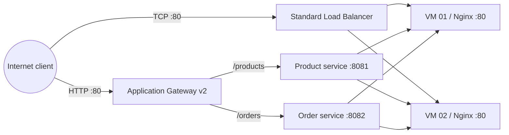

# Architecture Reference

## Overview

This lab compares a Standard Azure Load Balancer and an Application Gateway Standard_v2 instance. The two services share two Ubuntu backend VMs.

## Addressing

| Network | Address range |
|---|---|
| VNet | `10.20.0.0/16` |
| Backend subnet | `10.20.1.0/24` |
| Application Gateway subnet | `10.20.2.0/24` |

Inspect `infra/main.bicep` for exact resource names, NIC associations, backend addresses, probes, listener, and path-map definitions. Always compare this reference with the deployed template if you modify the implementation.

## Traffic paths

- Load Balancer: public frontend TCP port 80 → backend pool → backend VM port 80.
- Application Gateway: HTTP listener port 80 → URL path map → selected backend pool and HTTP settings → port 8081 or 8082.

## Important distinction

The Load Balancer distributes network flows; it does not choose the product or order service based on the HTTP URL. Application Gateway performs HTTP-aware path routing.
